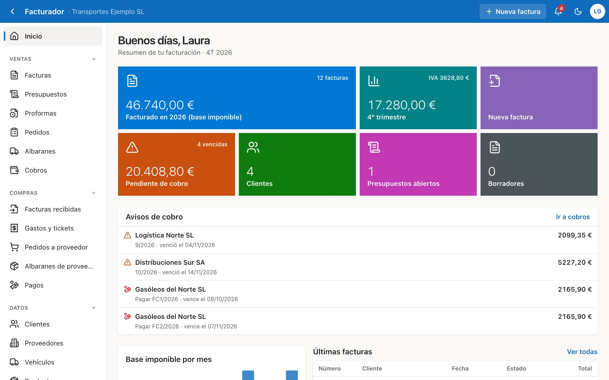

# Facturador

Facturación para autónomos y pymes en España. Código abierto (MIT), escrito desde cero y pensado para **instalarse en el servidor de tu empresa**: tus datos no salen de él.



- **Ventas completas**: facturas, rectificativas, simplificadas, presupuestos, proformas, pedidos y albaranes (valorados o no, firmados por el receptor en la pantalla), con conversión entre ellos y «Facturar el mes».
- **IVA completo**: tipos 21/10/4/0 %, exentas, exportación, intracomunitarias, inversión del sujeto pasivo, recargo de equivalencia, suplidos e IRPF, con las leyendas legales en el PDF.
- **Cobros y pagos**: vencimientos según plazos y días de pago de cada cliente, cobros parciales y avisos.
- **Compras**: facturas de proveedor, gastos y tickets, IVA deducible y gasto por vehículo.
- **Correo integrado**: cada usuario envía desde su propia cuenta (Google, Microsoft 365 o SMTP), con plantillas por tipo de documento y registro de envíos.
- **Informes**: modelo 303 (repercutido, soportado y resultado), 347 de clientes y proveedores, gasto por vehículo.
- **Plugins** desde GitHub: copias de seguridad, temas y diseño de PDF con firma digital.
- **Actualizaciones automáticas firmadas**, con vuelta atrás automática si algo falla.
- Interfaz al estilo Microsoft 365 / Metro, modo claro y oscuro, y adaptada al móvil.

📘 **[Manual de uso (PDF)](public/manual-facturador.pdf)**: también se puede descargar desde la pantalla de primera configuración y desde el menú de usuario de la aplicación.

## Tus datos, en tu servidor

Facturador se ejecuta en el servidor o el ordenador de la empresa y guarda toda la información en la carpeta `data/` de ese equipo. **No se sube nada a la nube.** No hay telemetría, ni cuentas en internet, ni servicios de terceros.

Solo se conecta a internet para:

| Para qué | A dónde | Qué envía |
|---|---|---|
| Buscar actualizaciones (cada hora) | `api.github.com` (Releases de este repositorio) | Nada de tu empresa |
| Ver e instalar plugins | `raw.githubusercontent.com` / `github.com` | Nada de tu empresa |
| Enviar un documento por correo, cuando tú lo pides | Tu proveedor de correo (Gmail, Microsoft 365 o tu SMTP) | El correo que envías |

## Instalación rápida

Necesitas **Node.js 22.13 o superior** (o Docker).

```bash
# Con Node.js: descarga la última Release (ya incluye todo), descomprímela y dentro de la carpeta:
npm start                    # http://localhost:9100

# Con Docker (desde el código fuente):
docker compose up -d --build
```

La primera vez se abre un asistente para crear la cuenta de administrador y los datos de la empresa.

Guía completa (servidor de la oficina, NAS, Windows, HTTPS, acceso desde fuera, variables): **[docs/instalacion.md](docs/instalacion.md)**.

## Documentación

| | |
|---|---|
| [Manual de uso (PDF)](public/manual-facturador.pdf) | Todo lo que hace la aplicación, pantalla a pantalla |
| [Instalación y puesta en marcha](docs/instalacion.md) | Requisitos, instalación, HTTPS, variables de entorno, copias |
| [Actualizaciones](docs/actualizaciones.md) | Cómo se actualiza sola de forma segura y cómo publicar versiones |
| [Correo](docs/correo.md) | Conectar Google, Microsoft 365 o SMTP |
| [Seguridad](docs/seguridad.md) | Medidas de seguridad y recomendaciones |
| [Plugins](docs/plugins.md) | Instalar plugins y crear los tuyos |
| [Importar desde FacturaScripts](docs/importar-facturascripts.md) | Migrar clientes, productos y facturas |
| [Arquitectura y desarrollo](docs/arquitectura.md) | Estructura del código, base de datos, API y pruebas |
| [Integración con Gestor DeCA](docs/integracion-deca.md) | Datos compartidos con Gestor DeCA y eCMR (en preparación) |

Plugins oficiales: **[im7manu/facturador-plugins](https://github.com/im7manu/facturador-plugins)**.

## Desarrollo

```bash
npm install
npm run dev        # API en :9100 + interfaz con recarga en http://localhost:8080
npm test           # pruebas de extremo a extremo (API, plugins y actualizaciones)
npm run typecheck
npm run build      # compila la interfaz en dist/
npm run manual     # regenera public/manual-facturador.pdf
```

Más detalles en [docs/arquitectura.md](docs/arquitectura.md) y [CONTRIBUTING.md](CONTRIBUTING.md).

## Lo que todavía no hace

- **VERI\*FACTU**: cada factura guarda una huella SHA-256 encadenada y el IVA se clasifica con los códigos de VERI\*FACTU, pero aún no se generan ni envían los registros a la AEAT. Se añadirá antes de que sea obligatorio.
- Contabilidad (asientos y plan de cuentas), almacenes y stock, tarifas, multiempresa y multidivisa.

## Origen y licencia

Código original, sin partes de otros programas de facturación. Licencia [MIT](LICENSE).

El estilo visual se inspira en el lenguaje de diseño de Microsoft (Fluent / Metro), pero no incluye logotipos, iconos ni fuentes de Microsoft. Este proyecto no está afiliado a Microsoft ni a FacturaScripts.
